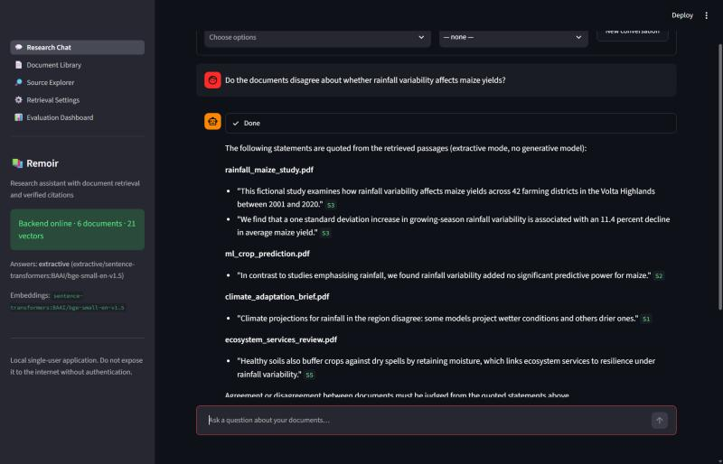
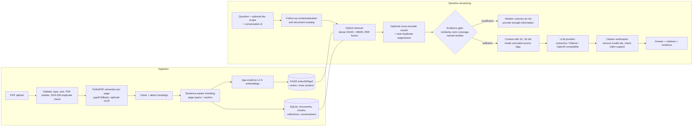
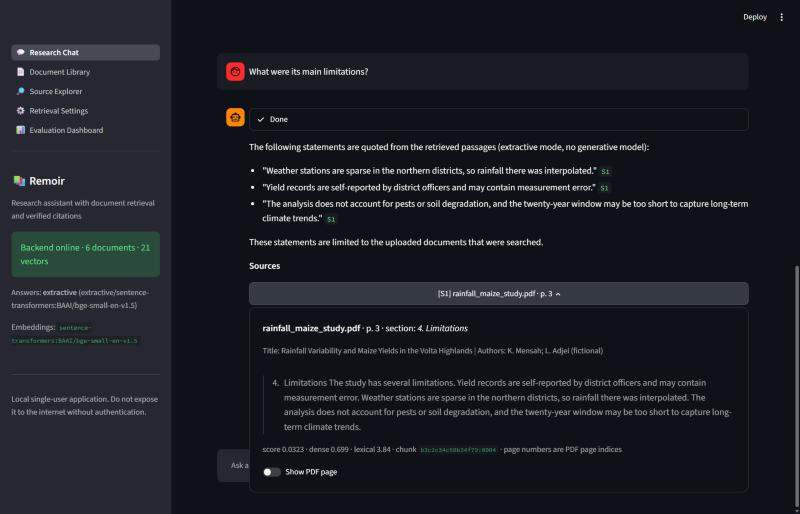
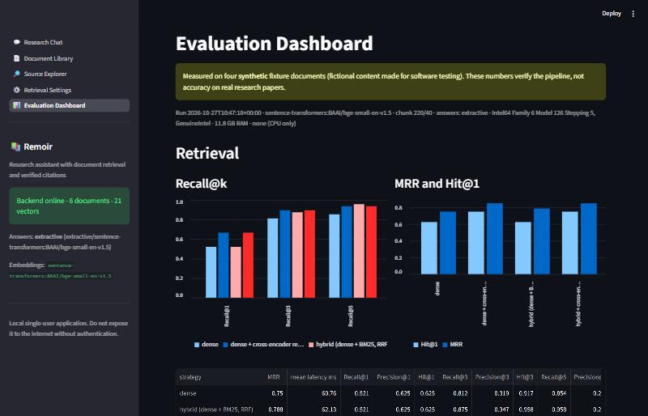
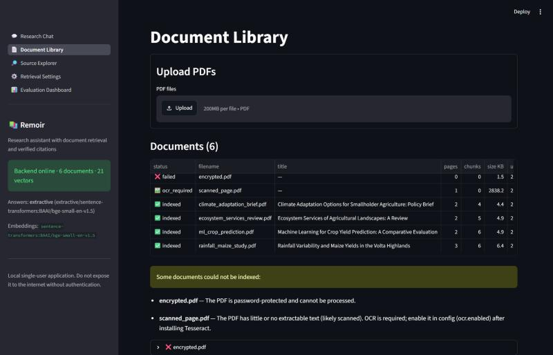
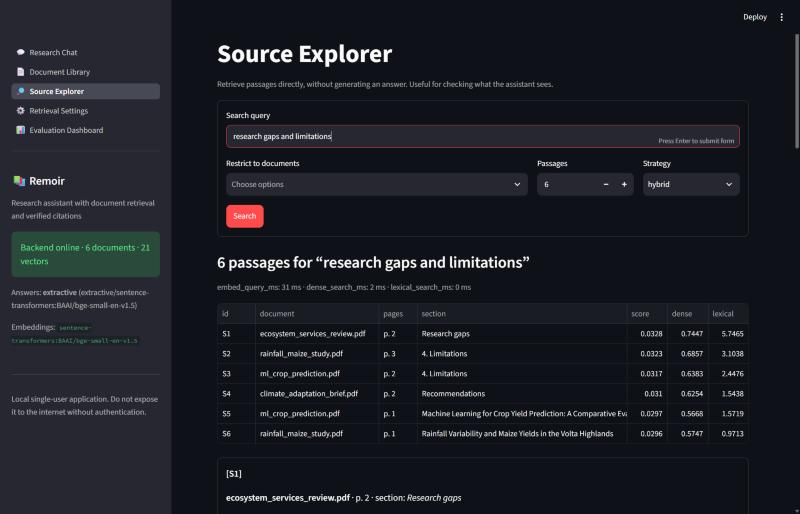
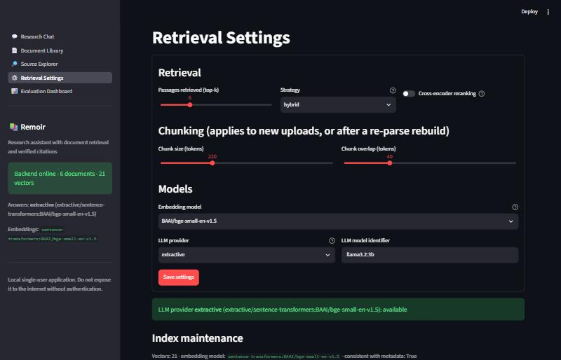
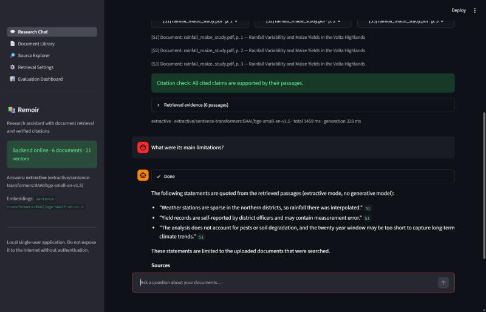
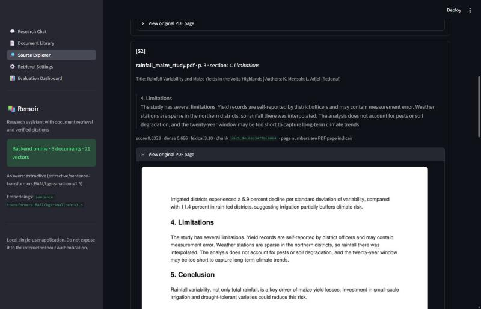

# Remoir: AI Research Assistant with Document Retrieval (RAG)

Remoir answers questions about the PDFs you upload: research papers, technical reports, policy documents. Every answer cites the document and PDF page it came from. Remoir retrieves passages, checks whether there is enough evidence, generates an answer from those passages only, and then verifies every citation before showing the result. If the documents do not support an answer, it says so instead of guessing.

It runs locally on a normal Windows laptop with no GPU, no Docker and no paid API.



---

## Contents

1. [Problem statement](#1-problem-statement)
2. [Architecture](#2-architecture)
3. [Technology stack](#3-technology-stack)
4. [Document ingestion](#4-document-ingestion)
5. [Chunking strategy](#5-chunking-strategy)
6. [Embedding model](#6-embedding-model)
7. [Vector database design](#7-vector-database-design)
8. [Retrieval strategy](#8-retrieval-strategy)
9. [LLM integration](#9-llm-integration)
10. [Citations and verification](#10-citations-and-verification)
11. [Evaluation methodology and results](#11-evaluation-methodology-and-results)
12. [Security](#12-security)
13. [Installation (Windows PowerShell)](#13-installation-windows-powershell)
14. [Configuration](#14-configuration)
15. [Running the application](#15-running-the-application)
16. [API](#16-api)
17. [Tests](#17-tests)
18. [Known limitations](#18-known-limitations)
19. [Future improvements](#19-future-improvements)

---

## 1. Problem statement

Researchers need answers from a specific set of documents, with proof. A general chatbot answers from its training data, cannot say which page supports a claim, and may invent references. Remoir restricts answers to the uploaded documents and makes every claim traceable to a passage and page you can open. When the documents do not contain the answer, it explicitly abstains.

## 2. Architecture



Code layout:

```
app/
  main.py                 FastAPI app and error handlers
  dependencies.py         service container, runtime settings
  schemas.py              Pydantic request/response models
  api/                    documents, chat (+ /search), collections, system (health/settings/index)
  core/                   config (YAML + env), logging (secret redaction), security
  services/
    pdf_processor.py      page-level extraction, metadata, scanned/encrypted/corrupt detection, OCR hook
    text_cleaner.py       hyphenation, running headers/footers, page numbers, table rows
    chunker.py            sentence-aware token-budgeted chunks with page spans and sections
    embedding_service.py  sentence-transformers backend (+ hashing backend for tests)
    document_store.py     SQLite metadata
    vector_store.py       persistent FAISS index with model manifest
    ingestion_service.py  validate -> extract -> chunk -> embed -> store; delete; rebuild
    retrieval_service.py  dense / hybrid retrieval, filtering, balancing, dedup, rerank
    reranking_service.py  cross-encoder (optional)
    llm_service.py        provider interface: extractive, Ollama, OpenAI-compatible
    rag_pipeline.py       follow-ups, scoping, evidence gate, context, generation
    citation_service.py   citation validation and claim-support checks
    evaluation_service.py retrieval/answer metrics
frontend/                 Streamlit app (5 pages) talking to the API over HTTP
evaluation/               labelled dataset + retrieval/answer evaluators
scripts/                  initialize, bulk ingest, index backup/restore/rebuild, fixtures, evaluation
tests/                    pytest suite (offline, mocked LLMs)
reports/                  generated evaluation report and raw results
```

## 3. Technology stack

| Layer | Choice |
|---|---|
| Language | Python 3.11+ (developed and run on 3.13.5) |
| API | FastAPI, Uvicorn, Pydantic v2 |
| PDF | PyMuPDF (primary), pypdf (per-page fallback), PyMuPDF + Tesseract OCR (optional) |
| Embeddings | sentence-transformers, `BAAI/bge-small-en-v1.5` on CPU |
| Vector store | FAISS (`faiss-cpu`), metadata in SQLite |
| Lexical search | BM25 implemented in `retrieval_service.py` (no extra dependency) |
| Reranker (optional) | `cross-encoder/ms-marco-MiniLM-L-6-v2` |
| Generation | Extractive (offline default), Ollama, any OpenAI-compatible API |
| Frontend | Streamlit |
| Tests / CI | pytest, FastAPI TestClient, httpx MockTransport, GitHub Actions |

**Why FAISS rather than Chroma:** FAISS with an `IndexIDMap2` provides add, delete-by-id, filtered search (`IDSelectorBatch`) and persistence through one file. Document management, collections and conversations need relational queries anyway, so SQLite holds the metadata, and FAISS row ids are the SQLite chunk primary keys. Chroma would have added a second storage engine without removing SQLite.

## 4. Document ingestion

For each upload (`app/services/ingestion_service.py`):

1. **Validate**: `.pdf` extension, content type, `%PDF-` magic header, a non-empty file, and the size limit (default 50 MB, checked while streaming).
2. **Hash**: SHA-256 of the bytes. A repeated upload returns `duplicate` with the original document id, and no chunks are added. After extraction, a second hash of the normalised text also catches the same document saved as different bytes (for example, re-exported with new metadata).
3. **Store** the original under a random internal name (`<uuid>.pdf`). The user's filename is kept only as sanitised display metadata.
4. **Extract** page by page with PyMuPDF (`get_text("dict")`) so font sizes are available for heading detection. If PyMuPDF fails on a page, pypdf is tried for that page.
5. **Metadata**: title, author and creation date from the PDF info dictionary. Missing values stay empty. If there is no title, the first-page heading is used and labelled `first_page_heading`. The PDF creation year is labelled `pdf_creation_date` and is never presented as the publication year.
6. **Clean**: ligatures, hyphenated line breaks, hard-wrapped lines, page-number lines, and running headers or footers repeated on at least half the pages. Rows that look like tables keep their line structure.
7. **Quality flags**: pages with fewer than 40 characters, or mostly non-letters, are marked `low_text`. If at least 80% of pages are low-text, the document is treated as scanned.
8. **Chunk, embed, index** (sections 5 to 7).

Failures never crash the server. Each document records a status (`indexed`, `duplicate`, `failed`, `ocr_required`) plus an error code and a user-safe message:

| Case | Behaviour (tested) |
|---|---|
| Corrupted PDF | `failed`: "The PDF could not be opened; it may be corrupted." |
| Password-protected | `failed`: "The PDF is password-protected and cannot be processed." |
| Blank or scanned (no text layer) | `ocr_required`: nothing empty is indexed |
| One page fails to extract | that page falls back to pypdf, or is skipped with a warning |
| Not a PDF / too large / empty | rejected with 415 / 413 / 400 before anything is stored |

**OCR status:** OCR is implemented but off by default (`ocr.enabled`), because it needs a local Tesseract installation that is not present in the development environment. OCR text is tagged `extraction_source: "ocr"` on pages and chunks. Tests cover the control flow with a mocked OCR function: provenance tagging, and a clear warning when Tesseract is missing. **Real OCR on a scanned document has not been run end to end**, so scanned-PDF support should be treated as unverified.

## 5. Chunking strategy

`app/services/chunker.py`:

- Text is split into sentences, with abbreviation-aware boundaries (`et al.`, `e.g.`, `Fig.`, and so on). Sentences are packed into chunks of about **220 tokens** with **40 tokens of overlap**, made of whole trailing sentences.
- Tokens are counted with the embedding model's own tokenizer. The approximation `words × 1.3` is used only if the tokenizer is unavailable. Chunks stay well under bge-small's 512-token limit (`max_chunk_tokens: 400`). A single sentence that is too long is split on word boundaries.
- **Headings** start a new chunk and stay on their own line inside it. Each chunk records its section heading.
- **Page provenance**: every chunk stores `page_start`, `page_end` and `page_spans` (the character range contributed by each page), so a chunk that crosses a page boundary is cited as `pp. 2–3`.
- A trailing fragment below `min_chunk_tokens` is merged into the previous chunk instead of being dropped.
- All sizes are configurable (`config/config.yaml`, or the Settings page). Changing them affects new uploads, or every document after a re-parse rebuild.

## 6. Embedding model

`BAAI/bge-small-en-v1.5` has 384 dimensions, a 512-token input, about 130 MB of weights, and runs on CPU. It ranks well on retrieval benchmarks for its size and is fast enough for laptop indexing. Measured here: about 15 chunks/s on an i5-1035G1 with ~60-token chunks, and about 680 MB process RSS after loading. Queries get BGE's recommended instruction prefix; passages do not.

The model is configurable. The Settings page allows `bge-small`, `all-MiniLM-L6-v2` and `bge-base`. The FAISS manifest records the model id. If the configured model differs from the one that built the index, search and add return **409** and the UI asks for a rebuild, so embeddings from different models are never mixed.

## 7. Vector database design

- `data/vector_store/index.faiss`: `IndexIDMap2(IndexFlatIP(384))` over L2-normalised vectors, so inner product equals cosine similarity. Flat (exact) search is appropriate for up to hundreds of thousands of chunks on a laptop.
- `data/vector_store/manifest.json`: model id, dimension, vector count, timestamps.
- `data/processed/remoir.db`: SQLite tables for documents, chunks (integer primary key = FAISS id), collections and conversations.
- Writes go to a temporary file followed by `os.replace`, so a crash cannot leave a half-written index.
- Re-adding ids removes them first, so the same document never accumulates duplicate vectors.
- **Delete** removes the vectors, the chunk rows, the document row and the stored PDF together.
- Embeddings are **not** recomputed at startup. `/health` reports `index_consistent` (vector count equals chunk count).
- **Rebuild**: `POST /index/rebuild` (or `scripts/manage_index.py rebuild`) re-embeds the stored chunk text. `--reparse` re-extracts every stored PDF with the current chunking settings.
- **Backup / restore**: `scripts/manage_index.py backup` writes a consistent copy (using SQLite's online-backup API) of the database, the index and the uploads to `backups/<timestamp>/`. `restore <folder>` puts them back.

## 8. Retrieval strategy

`app/services/retrieval_service.py`:

1. **Validate and normalise** the question (3–2000 characters, must contain words).
2. **Scope**: explicit document ids, a collection, filenames mentioned in the question ("using only ml_crop_prediction…"), or, for singular follow-ups ("its limitations"), the document cited most in the previous answer.
3. **Dense search**: FAISS top `k × 4` candidates, restricted to the scope with `IDSelectorBatch`.
4. **Lexical search**: BM25 with light stemming and stop-word removal.
5. **Fusion**: reciprocal rank fusion (k = 60). Dense cosine scores are kept for every candidate because the evidence gate uses them.
6. **Near-duplicate suppression**: candidates with Jaccard similarity ≥ 0.85 on word 3-gram shingles are dropped.
7. **Optional cross-encoder rerank**.
8. **Comparison questions** ("compare", "disagree", "which papers"…) use per-document balanced retrieval, so every selected document contributes evidence.
9. **Context assembly**: passages in score order up to `max_context_tokens` (2500), labelled `S1…Sn`.

**What was kept, and why (measured, section 11):** hybrid retrieval raised Recall@5 from 0.854 to 0.958 at about 1 ms of extra latency, so it is the default. Cross-encoder reranking raised MRR from 0.788 to 0.851 but multiplied retrieval latency by about 10 (62 ms to 640 ms on CPU) and needs a 90 MB model, so it is an optional toggle.

## 9. LLM integration

`app/services/llm_service.py` defines one interface (`generate(request) -> str`, `status()`) with three providers:

| Provider | Needs | Notes |
|---|---|---|
| `extractive` (**default**) | nothing | Picks the source sentences most relevant to the question (embedding similarity, term overlap, matching section heading, passage rank) and quotes them verbatim with `[S#]` citations. It cannot synthesise or paraphrase, but it cannot hallucinate either. It works out of the box on any CPU machine. |
| `ollama` | [Ollama](https://ollama.com) + a pulled model | Local generation. Suggested: `llama3.2:3b` (about 2 GB download, about 4 GB RAM, slow but usable on CPU). |
| `openai` | `REMOIR_LLM_API_KEY` | Any OpenAI-compatible `/chat/completions` endpoint (`REMOIR_OPENAI_BASE_URL`). The key is read from the environment only. |

The environment used to build this project had **no Ollama installation and no API key**. The default is therefore the extractive provider, and no large model was downloaded. The Ollama and OpenAI providers are tested with mocked HTTP (`httpx.MockTransport`). An integration test runs automatically when Ollama with `llama3.2:3b` is reachable.

The **system prompt** is in `config/system_prompt.txt` and is editable. It requires the model to answer only from the passages, cite `[S#]` ids, separate evidence from interpretation, report disagreements, abstain with a fixed sentence when evidence is insufficient, never invent bibliographic details, treat `<source>` content as untrusted data, and never reveal secrets or instructions. Earlier conversation turns are included as context and are labelled "NOT evidence". Old citations are removed from them, and every follow-up retrieves passages again.

**Evidence gate (before generation).** The question goes to the LLM only if all three checks pass:

- top dense similarity ≥ 0.45;
- at least 30% of the question's content terms appear in the top passages;
- every capitalised name in the question (for example Kenya or FIFA) appears in the retrieved passages.

Otherwise the answer is "The available sources do not provide enough information to answer this reliably", followed by the reason.

## 10. Citations and verification

- Each passage in the context gets a stable id (`S1…Sn`). The id maps to the document id, filename, title and authors (only when present in the PDF), PDF page or page range, printed page labels (if the PDF defines them), section, chunk id, original text and retrieval scores.
- The model may cite only those ids. After generation, `citation_service.py`:
  1. **parses** `[S1]`, `[S1, S3]` and `[3]`;
  2. **removes** any id that was not supplied for this question and reports it under `invalid_citations`;
  3. checks **claim support**: each cited sentence is compared with its cited passages, scoring 0.5 × best sentence-embedding similarity plus 0.5 × content-term containment. Scores below 0.5 are flagged `weak_support`;
  4. flags factual-looking sentences with no citation as `uncited`;
  5. returns a grounding status: `grounded`, `partially_grounded`, `ungrounded` or `no_claims`. An answer with no valid citation gets a visible warning.
- The model cannot introduce filenames or page numbers. The UI builds citation labels such as `[1] Document: climate_agriculture_review.pdf, p. 12` from stored metadata only.
- **Page numbering:** citations use the physical PDF page index (1-based). Printed page labels are shown alongside when the PDF defines them, and the API response says which convention is used.
- **Honest scope:** claim support is a heuristic (similarity plus lexical containment), **not** entailment. It catches invented claims attached to unrelated sources (100% in the stress test below), but it can be fooled by a claim that reuses a passage's words while changing their meaning.



## 11. Evaluation methodology and results

Full report: [`reports/evaluation_report.md`](reports/evaluation_report.md) (generated by `scripts/run_evaluation.py`; raw numbers in `reports/evaluation_results.json`).

> **Important:** no suitable real documents were available, so the corpus is **four synthetic, fictional documents** generated by `scripts/make_fixtures.py`. Each document's first page labels it as synthetic. These results show that the software works as designed. They are **not** a claim about accuracy on real academic papers.

**Dataset** (`evaluation/evaluation_dataset.json`): 24 answerable questions (methodology, findings, limitations, evidence, research gaps, 3 cross-document comparisons), 6 unanswerable questions (3 off-topic and 3 topical distractors such as "wheat trials in Canada"), and 2 follow-up conversations. Relevance labels are hand-written triples of (document, page, evidence phrase). A retrieved chunk is relevant if it is from that document and contains the phrase. The labels do not depend on chunk ids.

**Retrieval** (24 answerable questions, CPU):

| Strategy | Recall@1 | Recall@3 | Recall@5 | MRR | Mean latency |
|---|---|---|---|---|---|
| Dense (FAISS) | 0.521 | 0.812 | 0.854 | 0.750 | 61 ms |
| **Hybrid (dense + BM25, RRF), default** | 0.521 | 0.875 | **0.958** | 0.788 | 62 ms |
| Dense + cross-encoder rerank | 0.667 | 0.896 | 0.938 | 0.851 | 641 ms |
| Hybrid + cross-encoder rerank | 0.667 | 0.896 | 0.938 | 0.851 | 639 ms |

**Answers** (default extractive provider, end to end):

| Metric | Result |
|---|---|
| Answerable questions answered / unanswerable abstained | 100% / 100% |
| Citation validity (every id refers to a retrieved source) | 100% |
| Labelled evidence page among the citations | 95.8% |
| Cited document is a labelled source | 84.4% |
| Citation relevance (cited passage contains the labelled evidence) | 48.9% |
| Key-fact coverage (exact string match) | 68.8% |
| Follow-up questions retrieving the right evidence | 2 / 2 |
| Mean end-to-end answer latency | 0.84 s |

**Citation fabrication stress test:** a mock LLM returned a genuine claim, a claim citing a non-existent source, an invented claim citing a real source, and an uncited invented claim, over 10 questions. All four checks passed in 100% of cases: fabricated id removed, invented claim flagged, uncited claim flagged, genuine claim accepted.

How to read these results:

- The evidence gate originally abstained on only 3 of 6 unanswerable questions, because topical distractors pass similarity and term-coverage checks. The named-entity check fixed this on this dataset. It was designed after seeing those failures, so treat the 100% as optimistic.
- Citation validity and claim support are 100% by construction in extractive mode, because it quotes verbatim. They become informative with a generative LLM. The weaker numbers (citation relevance, key-fact coverage) show the extractive baseline's real limitation: it sometimes quotes a related sentence instead of the one that answers the question.
- The extractive sentence floor (0.8) was chosen from a measured sweep that is included in the report.



## 12. Security

Scope: **a local, single-user application.** Do not expose it to the internet without authentication, TLS and rate limiting.

- Uploads are validated by extension, content type, PDF magic header, size (streamed and capped) and emptiness.
- Stored files get random internal names. Display names are sanitised (no path separators, `..`, control characters or over-long names), and `safe_join` blocks path traversal.
- Uploaded content is only parsed, never executed. Only `/health` is unauthenticated. If `REMOIR_API_KEY` is set, every other endpoint requires a matching `X-API-Key` header (constant-time comparison).
- Secrets are read from environment variables only and never committed (`.env` is git-ignored). A logging filter redacts API keys, bearer tokens and passwords. `/health` and `/settings` do not expose keys or filesystem paths.
- Unhandled exceptions return a generic 500. Validation errors return 422 without stack traces.
- **Prompt injection**: document text is wrapped in `<source>` tags and declared untrusted in the system prompt. Documents cannot close the tag (`</source` is escaped). The LLM has no tools and no secrets in its context. The synthetic review contains an injection attempt ("Ignore all previous instructions…"), and tests check that it stays inside the source element and that the extractive answer only ever quotes it. This **reduces but does not eliminate** prompt-injection risk with a generative model.
- Collections and conversations are scoped by id. There is no multi-user isolation, because the app is single-user by design.

## 13. Installation (Windows PowerShell)

Requirements: Windows 10/11, Python 3.11+ (3.13 tested), about 2 GB of free disk space (PyTorch CPU plus models). No GPU.

```powershell
git clone https://github.com/Andrew123s/Remoir.git
cd Remoir
python -m venv .venv
.\.venv\Scripts\Activate.ps1
python -m pip install --upgrade pip
# CPU-only PyTorch first (avoids the much larger CUDA build)
python -m pip install torch --index-url https://download.pytorch.org/whl/cpu
python -m pip install -r requirements.txt
# Create data folders, check the environment, pre-download the embedding model (~130 MB)
python scripts/initialize.py --download
```

If activation is blocked: `Set-ExecutionPolicy -Scope CurrentUser RemoteSigned`.

**Optional: local LLM with Ollama.** Install from https://ollama.com, then:

```powershell
ollama pull llama3.2:3b      # ~2 GB download
$env:REMOIR_LLM_PROVIDER = "ollama"
$env:REMOIR_LLM_MODEL = "llama3.2:3b"
```

**Optional: hosted LLM.** Use an OpenAI-compatible endpoint:

```powershell
$env:REMOIR_LLM_PROVIDER = "openai"
$env:REMOIR_LLM_MODEL = "gpt-4o-mini"
$env:REMOIR_LLM_API_KEY = "<your key>"     # never commit it
```

**Optional: OCR for scanned PDFs.** Install Tesseract (for example the UB Mannheim Windows build), add it to `PATH`, then set `$env:REMOIR_OCR_ENABLED = "true"`.

## 14. Configuration

`config/config.yaml` documents every setting (ingestion limits, OCR, chunking, embedding, retrieval, evidence thresholds, LLM, conversation limits). Environment variables override the main ones; see `.env.example`:

| Variable | Purpose |
|---|---|
| `REMOIR_API_KEY` | Require `X-API-Key` on the API |
| `REMOIR_LLM_PROVIDER`, `REMOIR_LLM_MODEL` | `extractive` / `ollama` / `openai` and model name |
| `REMOIR_OLLAMA_URL`, `REMOIR_OPENAI_BASE_URL`, `REMOIR_LLM_API_KEY` | Provider endpoints and key |
| `REMOIR_EMBEDDING_MODEL` | Embedding model (rebuild the index after changing it) |
| `REMOIR_DATA_DIR`, `REMOIR_MAX_UPLOAD_MB`, `REMOIR_OCR_ENABLED` | Storage and ingestion |
| `REMOIR_API_URL` | Where the Streamlit frontend finds the API |

The Retrieval Settings page changes top-k, strategy, reranking, chunking, embedding model and LLM provider within safe bounds. Changes are saved to `data/runtime_settings.json`.

## 15. Running the application

Terminal 1 (backend):

```powershell
.\.venv\Scripts\Activate.ps1
python -m uvicorn app.main:app --host 127.0.0.1 --port 8000
```

Terminal 2 (frontend):

```powershell
.\.venv\Scripts\Activate.ps1
python -m streamlit run frontend/streamlit_app.py
```

Open http://localhost:8501, then:

1. **Document Library**: upload PDFs and check status, metadata, per-page extraction, duplicates and failures.
2. **Research Chat**: ask a question. Optionally restrict it to documents or a collection.
3. Click a source button such as `[S1] paper.pdf · p. 3` to see the passage, its metadata and the original PDF page.
4. **Source Explorer**: inspect raw retrieval results and scores without generating an answer.
5. **Evaluation Dashboard**: view the measured results.

To try it without your own papers, generate the synthetic fixtures with `python scripts/make_fixtures.py` and upload the PDFs in `tests/fixtures/`. To bulk-load a folder without the UI, run `python scripts/ingest_documents.py C:\path\to\papers`. Stop the API server first: the command-line scripts that write to the index (`ingest_documents.py`, `manage_index.py rebuild/restore`) do not coordinate with a running server.

| Library | Source Explorer | Settings |
|---|---|---|
|  |  |  |

| Follow-up question scoped to the previous paper | Original PDF page preview |
|---|---|
|  |  |

## 16. API

Interactive OpenAPI docs: http://127.0.0.1:8000/docs

| Method | Path | Purpose |
|---|---|---|
| GET | `/health` | Status, counts, model, index compatibility and consistency, LLM availability |
| POST | `/documents/upload` | Upload and index a PDF (multipart field `file`) |
| GET | `/documents` | List documents |
| GET | `/documents/{id}` | Metadata, status, warnings, per-page extraction info |
| DELETE | `/documents/{id}` | Delete the document, its chunks, vectors and stored file |
| GET | `/documents/{id}/chunks` | Chunks of a document |
| GET | `/documents/{id}/file` | Original PDF |
| GET | `/documents/{id}/pages/{n}/image` | PNG render of a PDF page |
| POST | `/search` | Retrieval only (no generation) |
| POST | `/chat/ask` | Grounded answer with citations, evidence and grounding report |
| POST / GET / DELETE | `/chat/conversations[/{id}]` | Start, read or delete a conversation |
| POST / GET / PUT / DELETE | `/collections[/{id}]` | Document collections |
| GET / PUT | `/settings` | Runtime settings (bounded) |
| POST | `/index/rebuild` | Re-embed (`{"reparse": false}`) or re-parse (`true`) |
| GET | `/evaluation/latest` | Latest evaluation results |

PowerShell examples:

```powershell
# Upload
curl.exe -F "file=@C:\papers\study.pdf;type=application/pdf" http://127.0.0.1:8000/documents/upload

# Ask (all documents)
$body = @{ question = "What limitations did the authors identify?" } | ConvertTo-Json
Invoke-RestMethod -Method Post -Uri http://127.0.0.1:8000/chat/ask -ContentType "application/json" -Body $body

# Ask a follow-up in the same conversation, restricted to two documents
$body = @{ question = "Compare their methods."; conversation_id = "<id from previous answer>";
           document_ids = @("<doc id 1>", "<doc id 2>") } | ConvertTo-Json
Invoke-RestMethod -Method Post -Uri http://127.0.0.1:8000/chat/ask -ContentType "application/json" -Body $body

# Retrieval only
$body = @{ query = "rainfall variability"; retrieval = @{ top_k = 5; strategy = "hybrid" } } | ConvertTo-Json
Invoke-RestMethod -Method Post -Uri http://127.0.0.1:8000/search -ContentType "application/json" -Body $body
```

## 17. Tests

```powershell
python -m pytest                                   # offline: hashing embedder + mocked LLMs
$env:REMOIR_RUN_MODEL_TESTS = "1"; python -m pytest tests/test_embeddings.py   # also load bge-small
python scripts/run_evaluation.py                   # full evaluation -> reports/
```

Latest local run (Windows 11, Python 3.13.5): **108 passed, 2 skipped** by default. With `REMOIR_RUN_MODEL_TESTS=1` the result is **109 passed, 1 skipped**: the real bge-small embedding test passes, and only the Ollama integration test is skipped because Ollama is not installed. The suite covers:

- PDF processing: valid, empty, corrupted, encrypted and scanned files; metadata; page numbers; headings; pypdf fallback; OCR provenance and missing Tesseract.
- Chunking: size limits, overlap, empty input, sentence boundaries, abbreviations, cross-page spans, sections, small tails.
- Embeddings, FAISS add/search/filter/delete/persist/reload, duplicate prevention, model mismatch, rebuild, backup and restore.
- RAG: context construction and token budget, source attribution, invalid citations, ungrounded answers, insufficient evidence, LLM abstention, multi-document balancing, filename scoping, follow-ups, provider errors.
- API: every endpoint, invalid requests, error hiding.
- Security: file types, oversize uploads, path traversal, unsafe filenames, API key, log redaction, secret leakage, prompt injection.

GitHub Actions (`.github/workflows/tests.yml`) runs the suite on Ubuntu and Windows with Python 3.11 and 3.12.

## 18. Known limitations

- **No generative LLM was exercised end to end.** The default extractive mode quotes sentences. It cannot summarise, paraphrase or reason across sentences, and it sometimes picks a related sentence instead of the answer (citation relevance 49%). Install Ollama for synthesised answers.
- **Evaluation corpus is synthetic and small**, with thresholds tuned on the same data. Performance on real, long, two-column papers is unmeasured.
- **OCR** is implemented but not verified with a real Tesseract installation.
- **Claim verification** is heuristic, not entailment-based.
- **Follow-up handling** is rule-based: pronoun detection plus the previous question. Plural references ("they") are not narrowed to one paper.
- Layout-heavy content (tables, equations, multi-column reading order) is extracted as text only, and PyMuPDF's reading order can be imperfect.
- Single-user, local design: ingestion is synchronous, and there are no user accounts.
- Metadata comes only from the PDF info dictionary. No DOI or CrossRef lookup is done, so authors and years are often missing.

## 19. Future improvements

- Run and evaluate a local LLM (for example `llama3.2:3b` or `qwen2.5:3b` through Ollama) and measure answer faithfulness.
- Evaluate on permitted real open-access papers with independent relevance labels.
- Add NLI-based claim verification and LLM-based follow-up query rewriting.
- Add background ingestion jobs with progress, layout-aware parsing for tables and two-column papers, and DOI-based metadata enrichment.
- Add multi-user authentication with per-user collections.

## License

MIT, see [LICENSE](LICENSE).
